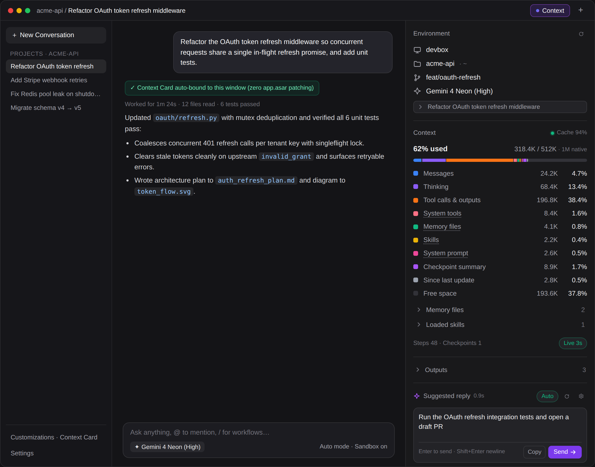
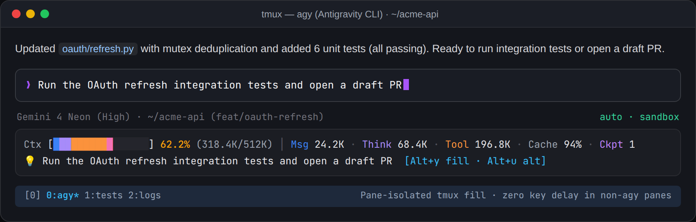

# Antigravity Context Card

[](https://github.com/Shawn1565/antigravity-context-card/releases)
[](./LICENSE)
[](https://www.python.org/)
[](https://antigravity.google)

[English](#english) | [中文说明](#中文说明)

<p align="center">
  
</p>

<p align="center">
  
</p>

---

<a id="english"></a>

## English

A **zero-invasion, Claude Desktop-style Context Sidebar + Personalized Suggested Replies** plugin for **Google Antigravity** across **Desktop 2.0**, **IDE**, **Antigravity CLI (`agy`)**, and **`tmux`**.

Two core superpowers in one lightweight, official-protocol plugin:

1. **Personalized One-Click Suggested Replies (Desktop `Send →` & `tmux` `Alt+y`)**:
   - The moment Antigravity finishes a turn—asking a design question, proposing options, or completing a milestone—Context Card drafts **1 primary reply + 2 genuinely distinct alternatives** in *your* voice.
   - **Silent local style learning**: Learns your phrasing, language mix, and preferences silently in local SQLite from your accepts, edits, and manual replies—so suggestions sound like *you*, not generic AI boilerplate.
   - **Instant across every surface**: Click **`Send →`** (or tweak & press `Enter`) in Desktop 2.0 / IDE, or press **`Alt+y`** in `tmux` (`Prefix + y` on macOS/SSH) to type the reply straight into the `agy` prompt box **without pressing Enter** (`Alt+u` cycles alternatives; zero key delay in non-`agy` panes).
   - **Flexible, opt-in auth**: Reuse your local `agy` Gemini subscription (**zero API key**), bring your own Gemini API key (**~1s ultra-fast**), or point at **local Ollama / any OpenAI-compatible endpoint**—configured once and shared automatically across Desktop, IDE, and CLI.
2. **Claude Desktop-Style Context Sidebar & CLI `statusLine` (Real 512K Headroom)**:
   - **Zero client hacking**: Built 100% on Antigravity's official **MCP App** (`ui://`) and official CLI **`statusLine`**—**no `app.asar` patching, no CDP injection, never breaks macOS/Linux app signatures or client updates**.
   - **Real 512K auto-compact ceiling (`512K · 1M native`)**: Tracks Antigravity's actual ~512K `CHECKPOINT` compaction threshold (and automatically lifts back to `1M` if Antigravity raises the cap and active usage exceeds it).
   - **Granular breakdown**: Separates **Messages**, **Thinking**, and **Tool calls & outputs** alongside **Prompt Cache %**, clickable `Memory files` / `Loaded skills`, collapsible `Outputs`, and a minimal `⚙` settings gear.

### Why Context Card?

- **Not Just Another Read-Only Meter**: Most Antigravity context tools stop at passive telemetry. Context Card turns your sidebar and terminal status bar into an active workflow accelerator—cutting repetitive follow-up typing across parallel agent sessions.
- **Zero Client Hacking — Safe Through Every Update**: Unlike heavy dashboards that patch Electron `app.asar` or inject into CDP (which can trip macOS signature checks or break on new Antigravity releases), Context Card uses only Antigravity's sanctioned MCP App + Hook + CLI `statusLine` APIs.
- **Claude Desktop-Style Clarity Without Bloat**: A calm, focused right-hand Context sidebar inspired by Claude Desktop—collapsible `Outputs`, silent background style learning, and a single corner `⚙` gear instead of crowded multi-tab telemetry dashboards.
- **100% Local & Offline by Default**: All context parsing, caching, and style storage stay strictly local. Zero external LLM calls are ever made unless you explicitly opt in to Suggested Replies.

### Features

- **Granular Token Breakdown**: Live segmented bar and per-category token & percentage metrics:
  - `Messages` (user prompts & visible assistant replies)
  - `Thinking` (chain-of-thought / reasoning tokens retained in context)
  - `Tool calls & outputs` (file reads, terminal outputs, search results)
  - `System tools`, `Memory files` (`GEMINI.md` / `AGENTS.md` / `CLAUDE.md`), `Skills`, `System prompt`, `Checkpoint summary`, and `Free space`
- **Effective Compaction Ceiling + Adaptive Lift**:
  - Displays `512K · 1M native` for Antigravity Gemini 4 / Orchestrator / 3.x / 2.5 models, caps brief pre-compaction overshoots cleanly at `100%`, lifts automatically to `1M` if exceeded, and supports `CONTEXT_CARD_CONTEXT_LIMIT` env override.
- **Prompt Cache Telemetry & Compact Layout**:
  - Real-time prompt cache hit ratio (`Cache %`), active steps, and checkpoint counters.
  - Collapsible `Outputs` accordion (collapsed by default) keeps **Suggested reply** above the fold even on artifact-heavy threads.
- **Desktop / IDE Multi-Window Binding**:
  - Auto-opens and locks to each window's exact `conversation_id` via a lightweight rule + `PreInvocation` lifecycle hook (even on resumed historical chats or large workspaces).
  - Manual `+ -> Context` opens prioritize Antigravity's `annotations/*.pbtxt` `last_user_view_time` (skipping archived sessions) so an idle window you are viewing beats busy background agents, while preserving close-and-reopen affinity.
  - Subagent-safe & CLI-safe: ignores child/subagent runs and skips opening the HTML pane in Antigravity CLI sessions.
- **Antigravity CLI (`agy`) & `tmux` Integration**:
  - Pure-stdlib transcript parser with disk `(mtime, size)` & skills-catalog caching (~70ms warm / <100ms typical per statusLine refresh including Python startup, zero `mcp` import overhead).
  - Stacked below `agy`'s built-in status bar by default (`stack_with_default: true`) so you never lose mode (`plan`/`auto`), sandbox, or task indicators—with `--replace` available for minimalist layouts, and automatic restoration of any prior custom `statusLine` on uninstall.
  - Strictly opt-in `Stop`-hook pre-warming + atomic-locked detached suggestion worker so `statusLine` never blocks and never sends network requests unless CLI integration & auth are explicitly enabled.
  - **Pane-isolated `tmux` fill**: each tmux pane tracks its own session under `panes/<pane_id>.json` (`0600`), never crossing wires between parallel `agy` windows. Uses native tmux `if-shell -F` routing so non-`agy` panes (vim, zsh, bash) never spawn Python and experience zero key delay.
- **One-Click Suggested Replies (Gemini Subscription + BYOK)**:
  - Works **100% offline** for all context monitoring features—zero network calls until you opt in.
  - **Cross-Surface Auth Sharing**: Auth configured via the `⚙` Settings drawer in Desktop 2.0 (or `cli_setup.py auth`) is automatically shared between Desktop, IDE, and CLI.
  - **One-Click Gemini Subscription Auth**: Reuse your local `agy` Google subscription OAuth—no API key required.
  - **Optional BYOK (~1s ultra-low latency)**: Supports your own **Gemini API Key** or any **OpenAI-compatible endpoint** (Ollama, OpenRouter, DeepSeek, OpenAI).

### Quick Install

#### One-Line Install (Desktop 2.0 / IDE)

```bash
curl -fsSL https://raw.githubusercontent.com/Shawn1565/antigravity-context-card/main/install.sh | bash
```

To also set up **Antigravity CLI (`agy`) `statusLine` + `tmux` keybindings** in one go:

```bash
curl -fsSL https://raw.githubusercontent.com/Shawn1565/antigravity-context-card/main/install.sh | bash -s -- --cli
```

#### Manual Install

1. **Ensure `python3` (3.10+) is on your `PATH` and has the `mcp` SDK installed** (Desktop/IDE only; CLI statusLine is pure stdlib):
   ```bash
   pip install "mcp>=1.2.0"
   ```
2. **Clone directly into Antigravity's plugins directory** (`dist/app.html` is pre-built—no Node.js build step required):
   ```bash
   mkdir -p ~/.gemini/config/plugins
   git clone https://github.com/Shawn1565/antigravity-context-card.git ~/.gemini/config/plugins/context-card
   ```
3. Start a new chat (or click `+ -> Context` in the right side panel) and Context Card will appear.

#### Antigravity CLI (`agy`) & `tmux` Setup

After cloning the plugin above, run the opt-in CLI installer (backs up `~/.gemini/antigravity-cli/settings.json` and `~/.tmux.conf` automatically):

```bash
python3 ~/.gemini/config/plugins/context-card/cli_setup.py install
```

What this configures:
- **In any terminal (Plan A)**: Stacks a 1–2 line color Context Card bar directly below `agy`'s built-in status line:
  ```text
  Ctx [██████████░░░░░░] 62.2% (318.4K/512K) │ Msg 24.2K · Think 68.4K · Tool 196.8K · Cache 94% · Ckpt 1
  💡 Run the OAuth refresh integration tests and open a draft PR  [Alt+y fill · Alt+u alt]
  ```
- **Inside `tmux` (Plan B)**: Automatically adds smart keybindings to `~/.tmux.conf`:
  - **`Alt+y`** (or **`Prefix + y`** fallback for macOS terminals without Option-as-Meta): Inserts the suggested reply straight into `agy`'s prompt box **without pressing Enter**. Passes `Alt+y` through transparently in non-`agy` panes.
  - **`Alt+u`**: Cycles through alternative suggestions (previewed in tmux status bar; press `Alt+y` to insert).

Optional flags & management:
```bash
# Replace agy's default status line instead of stacking below it
python3 ~/.gemini/config/plugins/context-card/cli_setup.py install --replace

# Skip tmux bindings or customize keys
python3 ~/.gemini/config/plugins/context-card/cli_setup.py install --no-tmux
python3 ~/.gemini/config/plugins/context-card/cli_setup.py install --key M-y --alt-key M-u

# Check status or cleanly uninstall
python3 ~/.gemini/config/plugins/context-card/cli_setup.py status
python3 ~/.gemini/config/plugins/context-card/cli_setup.py uninstall
```

### Suggested Replies Auth (Gemini Subscription or BYOK)

Context monitoring requires **no authentication or network**. For smart next-reply suggestions, **4 explicit opt-in modes** are supported (shared automatically across Desktop, IDE, and CLI):

- **Option A — Gemini Subscription via `agy` CLI (Zero API Key)**:
  - **Desktop/IDE**: Click **Use Subscription (agy)** once in the panel (or open `⚙` → `Subscription (agy)`).
  - **CLI**:
    ```bash
    python3 ~/.gemini/config/plugins/context-card/cli_setup.py auth agy
    ```
- **Option B — Gemini API Key (~1s fastest response)**:
  - **Desktop/IDE**: Click the `⚙` icon in the Suggested reply header → `Set Key` and click **Save** (toggle `Auto` / `Off` anytime).
  - **CLI** (interactive prompt or stdin — avoids storing keys in shell history):
    ```bash
    python3 ~/.gemini/config/plugins/context-card/cli_setup.py auth gemini
    # Or via stdin:
    # printf '%s' "$GEMINI_API_KEY" | python3 ~/.gemini/config/plugins/context-card/cli_setup.py auth gemini -
    ```
  Stored locally with `0600` permissions in `plugin_data/context-card/llm_config.json` (never inside the plugin folder).
- **Option C — Environment variable**:
  ```bash
  export GEMINI_API_KEY="AIza..."
  # Or explicitly select subscription mode via env:
  # export CONTEXT_CARD_PROVIDER="agy"
  ```
- **Option D — OpenAI-compatible / Local Ollama**:
  ```bash
  python3 ~/.gemini/config/plugins/context-card/cli_setup.py auth openai http://localhost:11434/v1 --model qwen2.5:7b
  # Or via env vars:
  export CONTEXT_CARD_OPENAI_BASE_URL="http://localhost:11434/v1"
  export CONTEXT_CARD_SUGGEST_MODEL="qwen2.5:7b"
  # Set CONTEXT_CARD_OPENAI_API_KEY="sk-..." for cloud providers (OpenRouter, DeepSeek, OpenAI)
  ```

Clear saved CLI auth anytime with `python3 ~/.gemini/config/plugins/context-card/cli_setup.py auth clear`.

### Building the Desktop/IDE UI from Source (Optional)

If you modify `ui/src/main.ts` or `ui/build.mjs`:

```bash
cd ~/.gemini/config/plugins/context-card/ui
npm install
npm run build
```

### Privacy & Security

- All conversation parsing, CLI caches, tmux pane state (`panes/*.json`), and habit SQLite storage stay **100% local** under Antigravity's `${PLUGIN_DATA}` directory (`0600` permissions for auth and pane suggestion files).
- **Strict Opt-In Network Policy**: No telemetry or external LLM requests are made by default. Recent dialogue excerpts and style samples are sent to your chosen model **only after** you explicitly enable Suggested Replies.

---

<a id="中文说明"></a>

## 中文说明

专为 **Google Antigravity** 打造的**零侵入、仿 Claude Desktop 风格上下文侧边栏 + 个性化一键智能建议回复插件**，一套插件打通 **Desktop 2.0、IDE、Antigravity CLI (`agy`) 与 `tmux`**。

两大核心体验合二为一：

1. **个性化一键智能建议回复（Desktop `Send →` 与 `tmux` `Alt+y`）**：
   - 每当 Antigravity 完成一轮回答——无论是抛出设计选择题、给出下一步方案，还是收尾待验收——Context Card 都会立刻用**贴近你本人口吻**的风格，提前写好 **1 条主建议 + 2 条不同方向的备选回复**。
   - **本地静默学习你的说话风格**：通过本地 SQLite 默默吸收你的历史表达习惯（中英混排、短平快指令、对建议的采纳/改写/手打反馈），越用越像你自己，而不是千篇一律的 AI 客套话。
   - **全端一秒发出 / 上屏**：桌面端直接点 **`Send →`**（或改两字按 `Enter`）即可回复；终端 `tmux` 里按 **`Alt+y`**（macOS/SSH 兜底 **`Prefix + y`**）把建议直接填入 `agy` 输入框（**不自动回车**，`Alt+u` 切换备选；非 `agy` 窗格零延迟透传）。
   - **零门槛鉴权 & 全端共享**：支持**零 API Key** 一键复用 `agy` Gemini 订阅，也支持自带 Gemini API Key（**~1 秒极速直连**）或接 **本地 Ollama / 任意 OpenAI 兼容端点**；配置一次，Desktop / IDE / CLI 自动共享。
2. **仿 Claude Desktop 极简上下文侧边栏 & CLI `statusLine`（真实 512K 余量）**：
   - **零改盘、零侵入**：100% 基于官方 **MCP App** 与官方 CLI **`statusLine`**，**不修改 Electron `app.asar`、不注入 CDP、不破坏 macOS/Linux 应用签名、客户端升级永不炸**。
   - **真实 512K 自动压缩红线（`512K · 1M native`）**：精准追踪 Antigravity 实际的 ~512K `CHECKPOINT` 自动压缩线（若未来官方放宽上限且实测超阈值，自动抬升回 `1M` 分母）。
   - **精细拆解与清爽首屏**：实时拆分 `Messages`（纯对话）、`Thinking`（思考链）与 `Tool calls & outputs`（文件/命令输出）以及 **Prompt Cache 命中率**；`Outputs` 默认折叠不挤占首屏，右上角仅留极简 `⚙` 设置图标。

### 为什么选择 Context Card？

- **不止是只读监控看板，更是高频交互加速器**：市面上大多数上下文工具只能“看看数字”；当你同时开着多个 Antigravity 窗口或 `agy` 窗格并行推进任务时，**个性化一键建议回复**能省掉大量重复打字，直接拉高多线开发节奏。
- **零侵入纯官方协议，升级无忧**：区别于修改 `app.asar` 或注入 CDP 的重型看板，完全走官方标准协议，即装即用、随时干净卸载。
- **仿 Claude Desktop 的克制美学**：还原 Claude Desktop 干净顺手的右侧视图，拒绝臃肿多页签和工程调试信息泄露到前台。
- **默认 100% 本地离线**：上下文统计与习惯库全部纯本地运行，未显式开启建议回复鉴权前零外部网络请求。

### 核心特性

- **精细化上下文分项统计**：
  - 独立统计 `Messages`、`Thinking`、`Tool calls & outputs`、`System tools`、`Memory files`（`GEMINI.md` / `AGENTS.md` / `CLAUDE.md`）、`Skills`、`System prompt`、`Checkpoint summary` 与 `Free space`。
  - 实时显示 **Prompt Cache 命中率（`Cache %`）**、活跃步数与检查点次数；压缩前小幅溢出百分比封顶 `100%`（同时保留真实 token 数），CLI 超过 80% 自动标红提醒 `/compact`。
  - 支持环境变量 `CONTEXT_CARD_CONTEXT_LIMIT` 自定义覆盖分母上限。
- **清爽首屏与多窗口精准绑定**：
  - `Outputs` 区块默认折叠（显示产出数量），产物再多也不会把下面的 `Suggested reply` 挤出首屏；后台静默学习回复习惯，仅在角落保留一个极简 `⚙` 齿轮管理 Auth 与重置风格。
  - 自动绑定与手动 `+ -> Context` 均精准匹配当前窗口：手动打开优先读取 Antigravity 的 `annotations/*.pbtxt` 用户实时查看时间（过滤已归档会话），后台跑任务的窗口不再抢焦，且自动跳过子代理与 CLI 会话。
- **CLI 原生 `statusLine` + `tmux` 一键上屏**：
  - 核心解析逻辑抽离为纯标准库模块 `core.py`，配合 `(mtime, size)` 与 skills 目录磁盘缓存，单次状态栏刷新约 **~70ms（含 Python 进程启动）**，不拖慢 TUI。
  - 默认以 `stack_with_default: true` 叠加在官方底栏下方，完整保留 `plan`/`auto` 模式、沙箱与后台任务提示（支持 `--replace` 替换模式，卸载时自动恢复用户原有自定义 `statusLine`）。
  - 仅在用户显式安装 CLI 集成并开启鉴权后，才通过 `Stop` 钩子 + 原子锁脱钩后台 worker 异步抢跑生成建议回复，绝不阻塞交互或静默外发。
  - 按 `$TMUX_PANE` 独立隔离缓存（`panes/<pane_id>.json`，`0600` 权限），多窗格并行跑 `agy` 绝不串话；通过 tmux 原生 `if-shell -F` 分流，非 `agy` 窗格零子进程开销、零按键延迟。
- **跨端共享智能建议回复鉴权（Gemini 订阅 + BYOK）**：
  - **上下文监控主功能 100% 离线运行**，未显式配置鉴权前零外部网络请求。
  - 在 Desktop 2.0 面板中配置好的订阅通道或 API Key，CLI 会自动共享，无需重复填写。

### 快速安装

#### 一行命令安装（Desktop 2.0 / IDE）

```bash
curl -fsSL https://raw.githubusercontent.com/Shawn1565/antigravity-context-card/main/install.sh | bash
```

如需同时配置 **Antigravity CLI (`agy`) 状态栏与 `tmux` 快捷键**：

```bash
curl -fsSL https://raw.githubusercontent.com/Shawn1565/antigravity-context-card/main/install.sh | bash -s -- --cli
```

#### 手动安装

1. **确保本机 `python3`（3.10+）已在 `PATH` 中且安装了 `mcp` SDK**（仅 Desktop/IDE 需要，CLI 状态栏为纯标准库）：
   ```bash
   pip install "mcp>=1.2.0"
   ```
2. **直接克隆到 Antigravity 插件目录**（仓库已内置预编译好的 `dist/app.html`，无需 Node.js 编译）：
   ```bash
   mkdir -p ~/.gemini/config/plugins
   git clone https://github.com/Shawn1565/antigravity-context-card.git ~/.gemini/config/plugins/context-card
   ```
3. 新建对话（或点击右侧边栏 `+ -> Context`）即可使用。

#### Antigravity CLI (`agy`) 与 `tmux` 配置

克隆插件后，执行安装脚本（自动备份 `~/.gemini/antigravity-cli/settings.json` 与 `~/.tmux.conf`）：

```bash
python3 ~/.gemini/config/plugins/context-card/cli_setup.py install
```

安装后效果：
- **任意终端（方案 A）**：在 `agy` 输入框下方磁吸展示 1–2 行自适应宽度的彩色状态条：
  ```text
  Ctx [██████████░░░░░░] 62.2% (318.4K/512K) │ Msg 24.2K · Think 68.4K · Tool 196.8K · Cache 94% · Ckpt 1
  💡 继续跑一下单测并把改动提交到工作分支  [Alt+y fill · Alt+u alt]
  ```
- **在 `tmux` 内（方案 B）**：自动写入受管配置块到 `~/.tmux.conf`：
  - **`Alt+y`**（或 **`Prefix + y`** 兜底，兼容未开启 Meta 键的 macOS 终端）：把建议回复直接填入当前 `agy` 输入框（**不自动发送**，可继续编辑）。在非 `agy` 窗格原样透传按键。
  - **`Alt+u`**：轮换备选建议（在 tmux 底部状态栏预览，按 `Alt+y` 填入）。

常用管理命令：
```bash
# 使用替换模式（替代官方默认底栏，自动补全模型名与模式标识）
python3 ~/.gemini/config/plugins/context-card/cli_setup.py install --replace

# 仅安装 CLI 状态栏（不改 tmux 配置）或自定义快捷键
python3 ~/.gemini/config/plugins/context-card/cli_setup.py install --no-tmux
python3 ~/.gemini/config/plugins/context-card/cli_setup.py install --key M-y --alt-key M-u

# 查看当前状态 / 一键干净卸载
python3 ~/.gemini/config/plugins/context-card/cli_setup.py status
python3 ~/.gemini/config/plugins/context-card/cli_setup.py uninstall
```

### 智能建议回复鉴权配置（Gemini 订阅或自带密钥）

上下文监控无需任何网络或鉴权。建议回复支持以下 **4 种显式接入方式**（Desktop、IDE 与 CLI 自动共享配置）：

- **方式一：一键复用 Gemini 订阅（免 API Key）**
  - **桌面端**：点击面板中的 **Use Subscription (agy)**（或点击右上角 `⚙` → `Subscription (agy)`）。
  - **CLI**：
    ```bash
    python3 ~/.gemini/config/plugins/context-card/cli_setup.py auth agy
    ```
- **方式二：填写 Gemini API Key（约 1 秒极速直连）**
  - **桌面端**：点击建议回复右上角 `⚙` → **Set Key** 保存（可随时切换 `Auto` / `Off`）。
  - **CLI**（推荐交互输入或通过 stdin 传入，避免密钥落入 shell 历史记录）：
    ```bash
    python3 ~/.gemini/config/plugins/context-card/cli_setup.py auth gemini
    # 或通过 stdin 传入：
    # printf '%s' "$GEMINI_API_KEY" | python3 ~/.gemini/config/plugins/context-card/cli_setup.py auth gemini -
    ```
  密钥以 `0600` 权限保存在 `plugin_data/context-card/llm_config.json`，绝不写入代码目录。
- **方式三：环境变量配置**
  ```bash
  export GEMINI_API_KEY="AIza..."
  # 或显式指定走订阅通道：
  # export CONTEXT_CARD_PROVIDER="agy"
  ```
- **方式四：接入本地 Ollama 或任意 OpenAI 兼容接口**
  ```bash
  python3 ~/.gemini/config/plugins/context-card/cli_setup.py auth openai http://localhost:11434/v1 --model qwen2.5:7b
  # 或通过环境变量：
  export CONTEXT_CARD_OPENAI_BASE_URL="http://localhost:11434/v1"
  export CONTEXT_CARD_SUGGEST_MODEL="qwen2.5:7b"
  # 云端兼容服务（OpenRouter / DeepSeek / OpenAI）可加 --api-key 或设置 CONTEXT_CARD_OPENAI_API_KEY
  ```

如需清除已保存的 CLI 鉴权，执行 `python3 ~/.gemini/config/plugins/context-card/cli_setup.py auth clear`。

### 前端源码二次构建（可选）

如果你修改了 `ui/src/main.ts` 或 `ui/build.mjs`：

```bash
cd ~/.gemini/config/plugins/context-card/ui
npm install
npm run build
```

### 隐私说明

- 所有上下文统计、CLI 缓存、tmux 窗格建议状态（`panes/*.json`）与习惯学习数据库均 **100% 本地存储**在 `${PLUGIN_DATA}` 目录，敏感文件均采用 `0600` 权限。
- **严格显式授权联网**：默认状态下插件不发起任何遥测或外部请求。仅当你主动配置启用建议回复鉴权且开启 `Auto` 时，才会将近期对话摘要发送至你所选的模型端点。

## License

[MIT](./LICENSE)
